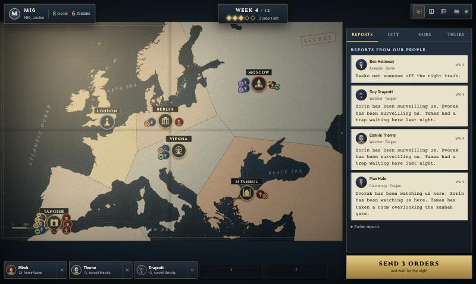

# Spymaster: MI6 vs the KGB

A Cold War spy duel against an opponent that actually thinks. You run MI6's network across a map of
Europe; Claude runs the KGB's. Everyone can see where every agent is. No one knows what they are, or
whose side they are really on.

*Your best agent may already be theirs.*

<p>
  <a href="https://majedgitsgood.github.io/moscow-rules/"></a>
</p>




## ▶ Play

**[Play it in your browser →](https://majedgitsgood.github.io/moscow-rules/)**
No install. Claude plays the KGB; if Claude is unavailable or the day's budget is spent, an offline
bot steps in and the game says so.

## The idea

A bite-sized spy game: one map, one opponent, a handful of agents, one question (who is still
yours?) and a finish in about half an hour. The design lives in **[SPEC.md](SPEC.md)**, the reasons
behind each choice in **[DECISIONS.md](DECISIONS.md)**, playtest notes in
**[FEEDBACK.md](FEEDBACK.md)** and release history in **[CHANGELOG.md](CHANGELOG.md)**.

## How to play

- Each side has 6, 8 or 10 agents: **Assassins** strike, **Watchers** surveil and learn roles,
  **Counterspies** set traps and check your own people's loyalty, **Recruiters** turn enemy agents.
- Each week you give four or five orders: click an agent on the map, pick an order, and say why if
  you like. Then the night plays out on the map, and the morning's reports arrive.
- Reports are clues, not verdicts: "has been asking about X" might be an attack being planned, or
  just someone checking up on a colleague. Watchers see what's really going on.
- Three visits from a Recruiter turn an agent. A turned agent still takes orders from its own side,
  and passes every one of them to yours.
- After twelve weeks, the side with the most agents working for it wins: its own loyal agents plus
  the enemy agents it has turned.
- The debrief replays the game: the moments that decided it, both sides' reasoning, a Tradecraft
  rating out of 100 for each side, and the agent who mattered most.

Two players can also play on one device (hot-seat). Readers of le Carré may find a way to play
it in his own words.

## Run it locally

```sh
npm install
cp .env.example .env     # add your ANTHROPIC_API_KEY (optional: offline without it)
npm start                # http://localhost:8643
```

Plain HTML, CSS and JavaScript modules: no build step. `server.js` serves the files and keeps the
API key away from the browser.

## How Claude is used

| Job | Model |
| --- | --- |
| The KGB's placement, weekly orders and private journal | `claude-opus-5-5` |
| The after-action debrief | `claude-opus-5-5` |
| Agents' voices in the morning reports | `claude-haiku-5-5` |

The rules engine decides everything that is true; Claude never states facts. The KGB sees only its
own fog-of-war view, and every rewritten report is fact-checked in code before it reaches you. The
browser never sees the key: `server.js` proxies `/api/claude`, picks the model, caps tokens and
gives guests a token budget (`MR_GUEST_BUDGET`); `MR_OWNER_TOKEN` skips it (open the game once with
`?owner=<token>`). With no key or no budget left, the game plays offline.

## Files

- `js/engine.js`: the rules (pure, deterministic). `js/world.js`: roles, cities, rosters.
- `js/controllers/`: `claude.js` (the KGB on Opus), `heuristic.js` (the offline bot).
- `js/voices.js`, `js/prompts.js`, `js/llm.js`, `js/analysis.js`: Claude's part and the debrief.
- `js/main.js`, `js/ui/`, `style.css`: the war room. `js/lexicon.js`: the on-screen vocabulary.
- `js/mapdata.js`: Europe from Natural Earth (public domain), generated by `npm run build-map`.
- `npm test` (rule checks) and `npm run simulate` (bot-vs-bot balance).

## License

© 2026 Majed Assa. Free to read, run and modify for personal, educational and other noncommercial use under
the **[PolyForm Noncommercial License 1.0.0](LICENSE.md)**. Commercial use, including selling the game or a
derivative of it, is reserved; get in touch through GitHub for a commercial licence.

An unofficial homage to John le Carré's Circus novels, with no affiliation. Agent names are original.
